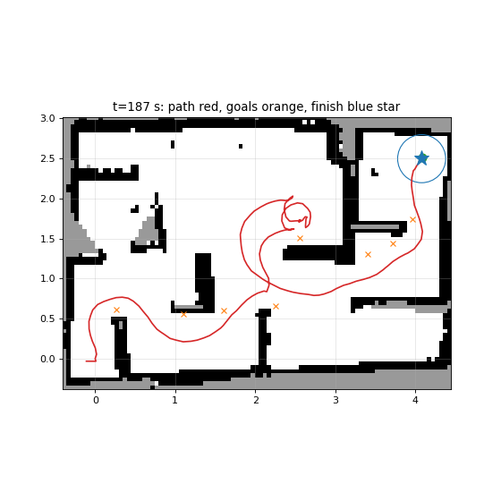

# Introduction

<!-- Rubric 20%: research and analyse the problem. Back every claim with a citation or own test. -->

A mobile robot has to sense what is around it, decide where to go and then act on
that decision, over and over [@benari2018elements; @corke2023robotics]. A maze is a
good test for this: walls, corridors and loops are easy to build and change, and
it's easy to see whether the robot made it. One way to solve a maze is to build a
map while driving. Simultaneous localisation and mapping (SLAM) estimates the
robot's position and a map of the walls at the same time
[@macenski2021slamtoolbox], and the robot explores by driving to frontiers, the
borders between the mapped and the unknown part [@yamauchi1997frontier].

## Problem statement

The task is to program an iRobot Create 3 to drive on its own from a start point to
a finish point through a maze it hasn't seen before. The floor is flat, the walls
are at about 90° to each other, and the maze can have loops. The start and the
finish are only given a few minutes before the demonstration.

<!-- Make the research question specific and measurable, never just "best". -->
Our research question is: *can frontier exploration on a SLAM map, running only on
the robot's Raspberry Pi 4, explore an unknown maze with loops and reach a finish
given relative to the start within one 8-minute run?*

## System description

@tbl-hardware lists the hardware and software. The Create 3 publishes its sensor
data and takes velocity commands over ROS 2 [@macenski2022ros2; @create3docs]. The
Raspberry Pi is connected to the Create 3 with USB-C and to the LiDAR with USB. It
runs the LiDAR driver, SLAM, Nav2 and the explorer node.

::: {#tbl-hardware layout-ncol=1}
| Component | Model / version | Role |
|---|---|---|
| Mobile base | iRobot Create 3 | wheels, bumper, odometry |
| Computer | Raspberry Pi 4 | runs SLAM, Nav2 and the explorer |
| LiDAR | Slamtec RPLiDAR A1M8 | 360° distance measurement [@rplidara1] |
| Operating system | Ubuntu 24.04 | on the Raspberry Pi |
| Middleware | ROS 2 Jazzy, Cyclone DDS | communication between nodes |
| Language | Python 3.12 | explorer node, launch files |

Hardware and software used.
:::

# Design

<!-- Rubric 25%: design a solution; compare at least 2 designs WITH literature for an 8. -->



# Methods

<!-- Experiments: calibration and validation. Must be reproducible (for a 10). -->

## Tests without the robot

The frontier search and the wall direction code are plain Python. They are tested
with 32 pytest cases on small hand-drawn maps and made-up scans. The ROS nodes were
tested without taking up the shared robot. A 271 s recording of a drive through the
maze, made on the robot on 2 October, was played back through slam_toolbox in a
separate ROS domain. The explorer's handling of Nav2 goals was checked against a
fake Nav2 action server.

## Simulation

Nav2 was tuned in a small 2D simulator written for this project. It stands in for
the Create 3 and the LiDAR inside the map of the course maze from 12 October. It
publishes odometry, transforms, scans and the dock, battery and bump topics,
answers the undock, rotate and reset requests, and treats the robot as a 0.171 m
disc that stops and reports a bump when it drives into a wall. slam_toolbox, Nav2
and the explorer ran on top of it without changes, in a separate ROS domain. The
original pure pursuit settings, a tuned pure pursuit, pure pursuit without its
collision check and several MPPI settings were compared.

## Runs on the robot

On 20 October there were 13 runs with a finish in the course maze, nine starting on
the dock and four on the floor. The finish was given as a distance and an angle
from the start pose. Every run was recorded as a rosbag with the map, pose,
odometry, scans, transforms, Nav2 plan, velocity commands, goals and bump events. A
monitor script logged the Raspberry Pi's temperature, the battery and the distance
to the finish every 10 s, and would stop a run above 82 °C. These runs used the
development version of the explorer from 20 October.

## Measurements

To compare SLAM settings, one recorded scan with a fixed pose was played to
slam_toolbox in four configurations, and the cells that stayed unknown at 0--1,
1--2, 2--3 and 3--4 m from the robot were counted. The CPU load of the explorer was
measured on the Raspberry Pi; for the Nav2 feedback rate this was done against a
fake Nav2 server. The code that ran in the demonstration has the tag
demo-2026-10-23 at <https://github.com/yeoblyv/corrida>.

# Results

<!-- Only facts and numbers here, no interpretation. -->

In the simulation (@fig-sim) the original pure pursuit settings got 3.2 m in 4 min
and got stuck after 100 s. With MPPI the robot explored the whole maze in 2 min,
drove 10.5 m and never touched a wall. With a finish, it got there in 64 s.

On the robot the finish was reached in 7 of the 13 runs (@tbl-runs), 0.02--0.11 m
from it and 40--178 s after the explorer started, with a median of 57 s. One run
stopped 0.38 m from the finish, two stopped after bumps, and in three the explorer
found no frontier left before it found the finish. @fig-run shows the longest
successful run. The highest Pi temperature per run was 72--81 °C. @tbl-results has
the other measurements.

::: {#tbl-runs layout-ncol=1}
| Run | Start | Result | Time (s) | Distance (m) |
|--------|-------|----------------------------|--------|--------|
| dock1 | dock | no frontier left | 33 | 3.94 |
| dock2 | dock | no frontier left | 53 | 2.08 |
| dock3 | dock | finish reached | 178 | 0.02 |
| dock4 | dock | finish reached | 64 | 0.04 |
| dock5 | dock | finish reached | 102 | 0.11 |
| dock9 | dock | stopped after bumps | 115 | 1.38 |
| dock10 | dock | stopped near finish | 130 | 0.38 |
| dock11 | dock | finish reached | 51 | 0.05 |
| mark6 | floor | stopped after bumps | 90 | 1.29 |
| mark7 | floor | finish reached | 45 | 0.08 |
| mark8 | floor | finish reached | 40 | 0.04 |
| spot1 | dock | no frontier left | 102 | 1.36 |
| spot2 | floor | finish reached | 57 | 0.05 |

Runs on the robot on 20 October. Time is counted from the explorer's first action. Distance is to the finish at the end of the run; for runs that didn't reach it, it's the closest distance in the 10 s monitor log.
:::

{#fig-run width="85%"}

::: {#tbl-results layout-ncol=1}
| Measurement | Result |
|-----------------------------------------|---------------------------|
| Unit tests, frontier search and wall direction | 32 of 32 passing |
| Unknown cells 3--4 m away, standing robot, travel thresholds 0.2 m / 0 | 95.7 % / 15.9 % |
| Explorer CPU load, Nav2 feedback at 100 Hz / 20 Hz | about 1/3 / 1/10 of a core |
| Explorer CPU load, scan and odometry always / only during set-up | 32 % / 18 % of a core |
| Pi temperature with two explorers running | 83 °C, throttling |
| Space at which pure pursuit stopped on the robot | 3--7 cm |

Results of the tests and measurements.
:::

Setting min_pass_through from 2 to 1 on top of zero travel thresholds didn't
change the share of unknown cells.

# Discussion and conclusion

The results show that the system only works on the Raspberry Pi once three things
fit the Create 3: the middleware, the reliability of the odometry topic and the
controller. Most of the CPU load came from Nav2's goal feedback and from handling
every scan and odometry message. After fixing that, one explorer used about a tenth
of a core, and the Pi stayed below 82 °C in all runs. Pure pursuit counted a few
centimetres of space as a hit and got stuck. MPPI looks at the distance to the
walls along its sampled trajectories, and it explored the whole simulated maze.

On the robot, frontier search with the finish term in @eq-goal reached the finish
in about half of the runs, always within 3 minutes and closer than 0.11 m. Three
runs ended with no frontier left before the finish was found, two stopped after
bumps and one stopped 0.38 m short of the finish.

There are two more limits. slam_toolbox gets slower in long runs, so the bringup is
restarted before every run. The finish is placed using odometry, so an error of 1°
in the start heading moves a finish 5 m away by about 9 cm. Overall, frontier
exploration on a SLAM map with Nav2 works on the Create 3's own Raspberry Pi 4.

# Acknowledgements {.unnumbered}

<!-- Grades are individual: show who did what and how much. -->

::: {#tbl-contrib layout-ncol=1}
| Member | Contribution | Share (%) |
|--------------------|----------------------------------------|----------|
| Marjan Rahimof | | |
| Daniel Chiemezie Nwadike | | |
| Mark Rijpstra | | |
| Yehor Oblyvantsov | Repository and workflow; LiDAR, SLAM and Nav2 setup; frontier explorer; simulator and robot tests; the navigation system used in the demonstration; Sections II--V of this report | 62 |

Contribution of each group member. Share: non-blank lines each member added to the project repository, all branches.
:::

# References {.unnumbered}

::: {#refs}
:::
