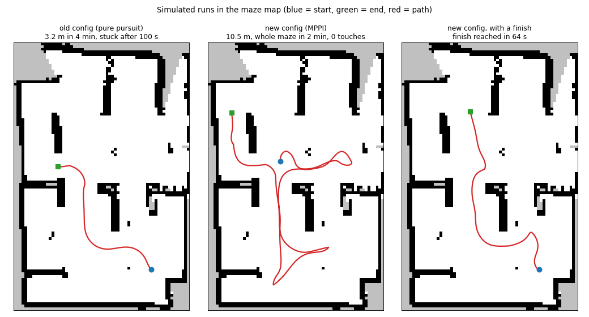

The system that ran in the demonstration uses a map. While the robot drives, the
LiDAR builds an occupancy grid, the explorer node picks the next goal on it, and
the Nav2 navigation stack plans a path there and follows it [@macenski2020marathon].
It uses the LiDAR, the wheel odometry, the bumper and the battery state, and
everything runs on the Raspberry Pi in the robot's ROS 2 namespace (@tbl-layers).

::: {#tbl-layers layout-ncol=1}
| Layer | Software | Configuration |
|--------------|--------------------|--------------------------------------------|
| Sensing | rplidar_ros 2.1.0 | 360° scans, LiDAR mounted backwards |
| Mapping | slam_toolbox 2.8.4 | online asynchronous mapping, 5 cm cells |
| Exploration | own explorer node | frontiers, goal choice, finish, wall alignment |
| Planning | Nav2 NavFn planner | path on the map, replanned once a second |
| Control | Nav2 MPPI controller | at most 0.15 m/s, no reversing |
| Safety | Nav2 collision monitor | stops 1.2 s before a predicted hit |

Software layers of the navigation system.
:::

## Mapping

slam_toolbox matches each scan against the map to work out where the robot is, and
keeps a grid of free, occupied and unknown cells [@macenski2021slamtoolbox]. The
LiDAR is mounted backwards, so a static transform with a 180° yaw turns it around.
At first no odometry or transforms arrived on the Pi. That only worked after
switching from Fast DDS to Cyclone DDS, which is what the Create 3 runs
[@create3docs]. The minimum travel thresholds are set to zero, so the map keeps
getting new scans while the robot stands still (@tbl-results).

## Frontier exploration

A frontier is the border between known free space and unknown space
[@yamauchi1997frontier]. On every new map a breadth-first search starts at the
robot and spreads through free cells. It gives every reachable cell $c$ its path
length $n(c)$. Reachable free cells next to unknown space make up the frontiers.
Frontiers shorter than 0.4 m are dropped, because the robot is 0.35 m wide. On each
frontier the goal candidate is the cell furthest from the walls, at least 0.25 m
from them and 0.3 m from earlier goals. The next goal is

$$
g^{*} = \arg\min_{g \in G} \left( n(g) + \lVert g - f \rVert \right),
$$ {#eq-goal}

where $\lVert g - f \rVert$ is the straight-line distance to the finish $f$. This is
the same idea as the node cost in A* [@hart1968astar]: the robot explores in the
direction of the finish. Without a finish only $n(g)$ counts. As soon as there's a
reachable cell within 0.3 m of the finish, that cell becomes the goal. A goal is
cancelled when its frontier gets explored on the way, and dropped after 90 s. The
explorer stops after three bumps, at 20 % battery or when the time is up.

## Alignment with the walls

Before exploring, the robot leaves the dock and turns until it's parallel to the
walls, so the walls run along the map axes. Every window of seven scan points that
is close to a straight line gives a direction $\varphi_i$ and a length $l_i$.
Multiplying the directions by four makes all right angles the same angle, so the
wall direction is

$$
\theta = \frac{1}{4}\,\operatorname{atan2}\!\left( \sum_i l_i \sin 4\varphi_i,\; \sum_i l_i \cos 4\varphi_i \right).
$$ {#eq-walls}

The robot only turns if at least 60 % of the wall length is within 10° of
$\theta$. It turns until $|\theta| \le 1^\circ$ and then resets the odometry and the
map. A finish given as a distance and an angle from the start pose is then moved
into the new map frame.

## Navigation

Nav2 uses a configuration based on the TurtleBot 4, which has the same base and
LiDAR [@turtlebot4nav]. The Create 3 sends its odometry as best effort, but Nav2
wants reliable messages [@ros2qos], so a small relay node sends it on as reliable.
The Create 3 only drives backwards a few centimetres [@create3safety], so reversing
and the BackUp recovery are turned off. At first the controller was Regulated Pure
Pursuit [@macenski2023rpp]. It stopped next to walls, because its collision check
counted 3--7 cm of space as a hit. It was replaced by MPPI [@williams2018mppi],
which samples 1,000 trajectories 3 s ahead at up to 0.15 m/s and gives paths close
to walls a high cost (@fig-sim). A collision monitor slows the robot down 1.2 s
before a predicted hit.

{#fig-sim fig-env="figure*" width="100%"}

## Development

The system was built between 30 September and 20 October. @tbl-devproblems lists
the problems found on the robot and how they were fixed.

::: {#tbl-devproblems layout-ncol=1}
| Problem on the robot | Cause | Fix |
|-------------------------|-----------------------|-------------------------------|
| No odometry or transforms | Fast DDS on the Pi, Cyclone DDS on the robot | Cyclone DDS everywhere |
| Nav2 gets no odometry | best effort vs. reliable QoS | relay node |
| Explorer uses a third of a core, Pi throttles at 83 °C | Nav2 feedback at 100 Hz, two explorers running | feedback at 20 Hz, lighter node |
| Robot stops at walls and in doorways | pure pursuit collision check | MPPI |

Problems found during development and how they were fixed.
:::
