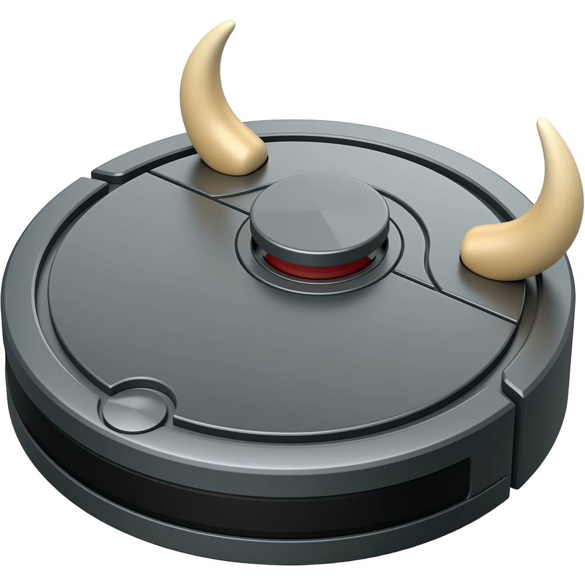

<p align="center">
  
</p>

<h1 align="center">Corrida</h1>
<p align="center"><i>Robot maze navigation — Team 6</i></p>

<p align="center">
  <a href="https://docs.ros.org/en/jazzy/"></a>
  <a href="https://releases.ubuntu.com/24.04/"></a>
  
  
  
  
  <a href="LICENSE"></a>
</p>

Hanze Master Smart Systems Engineering, Introduction Project -
Semester 1, 2026/2027. Program an iRobot Create 3 to autonomously navigate
an unknown maze, fusing its IR proximity sensors and a self-installed LiDAR, via ROS2.

## Quickstart

On Ubuntu 24.04 with ROS 2 Jazzy:

```bash
git clone https://github.com/yeoblyv/corrida.git
cd corrida
source scripts/env.sh
./scripts/install-deps.sh
./scripts/build.sh
source scripts/env.sh
```

On the robot's Pi, with the lidar plugged in, this starts the lidar driver
and slam_toolbox:

```bash
ros2 launch corrida_bringup bringup.launch.py
```

## Hardware & environment

* **Robot:** iRobot Create 3 - 7x IR obstacle sensors, 4x cliff sensors,
  optical odometer.
* **Added:** self-installed LiDAR (RPLIDAR A1M8) + Raspberry Pi 4.
* **Maze:** unknown to the robot, flat ground, walls at about 90 degrees,
  may contain loops, fixed start/finish positions.
* **Run window:** 8 + 8 minutes (disjoint attempts) on demo day.
* **Environment:** ROS 2 Jazzy Jalisco on Ubuntu 24.04 (VM or Raspberry Pi
  4), Foxglove for visualization. [AGENTS.md](AGENTS.md) has the rules for
  AI assistants used with this repo.

## Team - Group 6

* **Mark Rijpstra** - leader
* **Marjan Rahimof** - planning and communication
* **Yehor Oblyvantsov** - GitHub and the repo, puts the final report together
* **Daniel Chiemezie Nwadike** - meeting minutes
* Tutor: Ewout Bergsma

Everyone works on the code. The roles are from our first meeting, see
[ADR-0001](docs/adr/0001-team-roles-and-working-agreement.md).

## Deadlines

| Date | Deliverable | Graded |
| --- | --- | --- |
| 2026-09-20 | Individual learning goals + plan | No |
| 2026-09-29 | Group progress presentation | No |
| 2026-10-20 | Group demonstration | Yes |
| 2026-10-25 | Group report (IEEE, max 6 pages) | Yes |
| 2026-11-02 | Individual reflection | No |

The dates, the maze rules and the group list are from the kickoff slides
(E. Bergsma, F. N. Martins, & F. J. Guzman, personal communication,
September 11, 2026). If Brightspace says something else, Brightspace wins.

## Repository structure

- `src/` - ROS 2 packages (colcon workspace)
- `tests/` - pytest tests for logic that doesn't need the robot
- `notebooks/` - Jupyter notebooks with demos and notes
- `scripts/` - setup, build and lint helpers
- `docs/` - git cheatsheet, Pi accounts, references, decisions (`adr/`)
- `vms/` - local VM snapshots, not in git

## Working rules

How we work is in [CONTRIBUTING.md](CONTRIBUTING.md). The day-to-day git
commands are in [docs/git-cheatsheet.md](docs/git-cheatsheet.md), and how
we cite sources is in [docs/REFERENCES.md](docs/REFERENCES.md).

## License

Code (`src/`, `scripts/`, `notebooks/`, `tests/`) is MIT, see
[LICENSE](LICENSE). The documentation and the report are CC BY 4.0, see
[LICENSE-DOCS](LICENSE-DOCS). A license doesn't allow using this work for
your own coursework, Hanze's academic integrity rules decide that. Why
there are two licenses is in [ADR-0002](docs/adr/0002-licensing.md).
